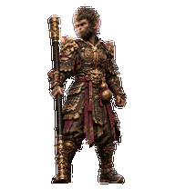
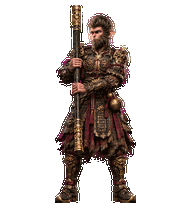
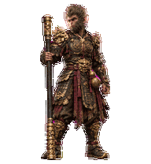
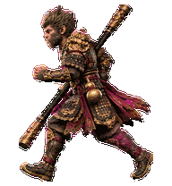
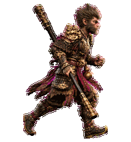
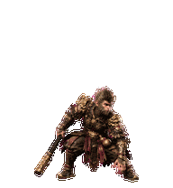

# 天命人 · 黑神话悟空 / The Destined One

以《黑神话：悟空》天命人为原型的 Codex 桌面宠物：半写实黑金甲胄、暗红衣袍、腰间葫芦与金箍长棍，包含九类动画及十六个指针朝向。此仓库发布已完成的原版宠物，不重新绘制角色。

A Codex desktop pet inspired by the Destined One from *Black Myth: Wukong*: semi-realistic black-and-gold armor, burgundy cloth, waist gourd and gold-ended staff. Includes nine animation states and sixteen pointer directions. This repository distributes the completed original pet without regenerating its artwork.

**个人、非商业使用；非官方项目，与游戏科学或 OpenAI 无隶属、赞助或合作关系。 / Personal, non-commercial use only. Unofficial; not affiliated with, sponsored by or endorsed by Game Science or OpenAI.** See [使用与权利说明 / Notice](NOTICE.md).

[下载 v1.0.0 / Download v1.0.0](https://github.com/breezing2008/CodexPet_BlackMyth_Wukong/releases/tag/v1.0.0) · [安装提示词 / Installation prompt](INSTALL_PROMPT.md) · [设计依据 / Sources](docs/SOURCES.md)

## GIF 预览 / Animated previews

| 待机 / Idle | 工作练棍 / Working | 需要接手 / Needs input |
| --- | --- | --- |
|  |  |  |

| 左向移动 / Move left | 右向移动 / Move right | 腾跃 / Leap |
| --- | --- | --- |
|  |  |  |

GIF 为动作素材演示，并非应用实时录像。实际状态切换、提醒优先级和拖拽行为由应用控制。 / GIFs demonstrate the supplied artwork, not recorded app behavior. The app controls state selection, reminder priority and dragging.

## 安装 / Install

适用于支持自定义 v2 宠物的 Codex 桌面版本。安装脚本仅需 Python 3.9+ 标准库；可选素材验证需要 Pillow。桌面 v2 包与网页上传格式不同，不应直接当作网页上传素材。 / Requires a Codex desktop build supporting custom v2 pets. The installer needs only Python 3.9+; optional asset validation requires Pillow. This desktop v2 package is not a web-upload package.

1. 从 [Releases](https://github.com/breezing2008/CodexPet_BlackMyth_Wukong/releases) 下载完整 ZIP 并解压，或克隆此仓库。 / Download and extract the full ZIP from Releases, or clone this repository.
2. 进入解压后的项目目录，先预览再安装。 / In the extracted project directory, preview and then install:

```sh
python3 scripts/install.py --dry-run
python3 scripts/install.py
```

3. 打开设置 → Pets（宠物），点击 Refresh（刷新），选择“天命人 · 黑神话悟空”；需要时输入 `/pet` 显示。刷新与显示步骤依据 [OpenAI 官方 Pets 文档](https://learn.chatgpt.com/docs/pets)。 / Open Settings → Pets, click Refresh and choose “天命人 · 黑神话悟空”. Enter `/pet` to show it if needed; see the [official OpenAI Pets documentation](https://learn.chatgpt.com/docs/pets).

默认目录为 `~/.codex/pets/black-myth-destined-one/`；设置了 `CODEX_HOME` 时使用其 `pets` 子目录，也可通过 `--pets-dir` 指定目录。脚本检查 SHA-256、保留其他宠物、备份不同版本，不修改当前选中项或全局设置。备份存放在宠物目录同级的 `pet-backups/black-myth-destined-one/`。 / The default is `~/.codex/pets/black-myth-destined-one/`, or `CODEX_HOME/pets` when configured; override with `--pets-dir`. The installer checks SHA-256, preserves other pets, backs up differing versions, and does not change selection or global settings. Backups are stored in the sibling `pet-backups/black-myth-destined-one/` folder.

没有 Python 时，可将 `pet/` 中的两个文件手动复制到上述宠物目录，然后刷新列表；覆盖旧版本前请先备份。 / Without Python, manually copy both files from `pet/` to the pet directory, back up an existing version first, then refresh the list.

也可以直接把 [安装提示词](INSTALL_PROMPT.md) 发给自己电脑上的 Codex。 / You can also give the [installation prompt](INSTALL_PROMPT.md) to Codex on your computer.

## 动作 / Motions

| 状态 / State | 帧数 / Frames | 动作设计 / Motion |
| --- | ---: | --- |
| `idle` | 6 | 呼吸、肩部与重心变化 / Breathing, shoulder and weight shifts |
| `running-right` | 8 | 向右持棍步法 / Rightward staff-wielding gait |
| `running-left` | 8 | 向左持棍步法 / Leftward staff-wielding gait |
| `waving` | 4 | 扶棍招手 / Staff-supported greeting |
| `jumping` | 5 | 收身腾跃、劈落与落地 / Compact leap, smash pose and landing |
| `failed` | 8 | 低头、肩部下沉后恢复 / Restrained head-and-shoulder bow and recovery |
| `waiting` | 6 | 立棍抬身、招手、回落循环 / Pillar-inspired perch, beckon and return |
| `running` | 6 | 原地紧凑棍花 / Stationary staff-flower drill |
| `review` | 6 | 短程戳棍与收棍检视 / Compact thrust guard and inspection |
| `look` | 16 directions | 指针驱动的眼、头颈和肩部朝向 / Pointer-directed eyes, head, neck and shoulders |

查看 [全部 GIF / All GIFs](previews/)、[动作总览 / Contact sheet](docs/contact-sheet-extended.png) 和 [朝向总览 / Direction overview](docs/look-directions.png)。`look.gif` 是连续朝向演示，实际朝向由指针驱动。 / `look.gif` demonstrates a direction sequence; actual gaze is pointer-driven.

## 验证与边界 / Validation and limits

原始宠物于 2026-10-14 完成本机安装，用户确认点击刷新后出现在设置列表。该确认不等同于所有平台、版本或每个播放状态均经过实机测试。 / The original pet was installed locally on 2026-10-14, and the user confirmed it appeared after Refresh. This does not establish testing on every platform, build or playback state.

发布检查覆盖图集格式、所有有效帧、透明空白格、透明像素 RGB 清理、十个循环 GIF、SHA-256、ZIP 完整性及安装脚本安全用例。详见 [QA](qa/README.md)。保留原素材的已知限制：部分斜向视线较细微，受阻动作偏克制。 / Release checks cover atlas format, populated and blank cells, transparent-pixel RGB cleanup, ten looping GIFs, SHA-256, ZIP integrity and installer safety cases. See [QA](qa/README.md). Existing visual limits remain: some diagonal gaze cues are subtle, and the blocked reaction is restrained.

```sh
python3 -m pip install -r requirements-dev.txt
python3 scripts/validate.py
python3 scripts/test_install.py
```

若列表没有新宠物，先点击 Pets 的圆形刷新控件；仅切换设置页可能不够。若没有动画，检查操作系统“减少动态效果”设置。自定义桌面宠物不会自动同步到其他电脑。 / If missing, use the circular Refresh control in Pets; merely reopening Settings may not rescan. If static, check the operating system's reduced-motion setting. Custom desktop pets do not automatically sync to other computers. [官方说明 / Official guidance](https://learn.chatgpt.com/docs/pets).

## 项目内容 / Contents

- `pet/`：未经改动的清单与透明 v2 图集。 / Unmodified manifest and transparent v2 atlas.
- `previews/`、`docs/`：GIF、总览、资料来源及原始生成提示词。 / GIFs, overviews, sources and original generation prompts.
- `scripts/`、`qa/`：安全安装、校验、测试与不含私人路径的报告。 / Safe installer, validators, tests and reports without private paths.
- `checksums.sha256`：发布文件校验清单；ZIP 的校验值随 Release 单独提供。 / Release-file checksums; ZIP digests are supplied separately with the Release.

不包含游戏模型、官方参考图片原文件、本机诊断日志或账户凭据。 / No game models, original downloaded official reference images, local diagnostic logs or account credentials are included.
